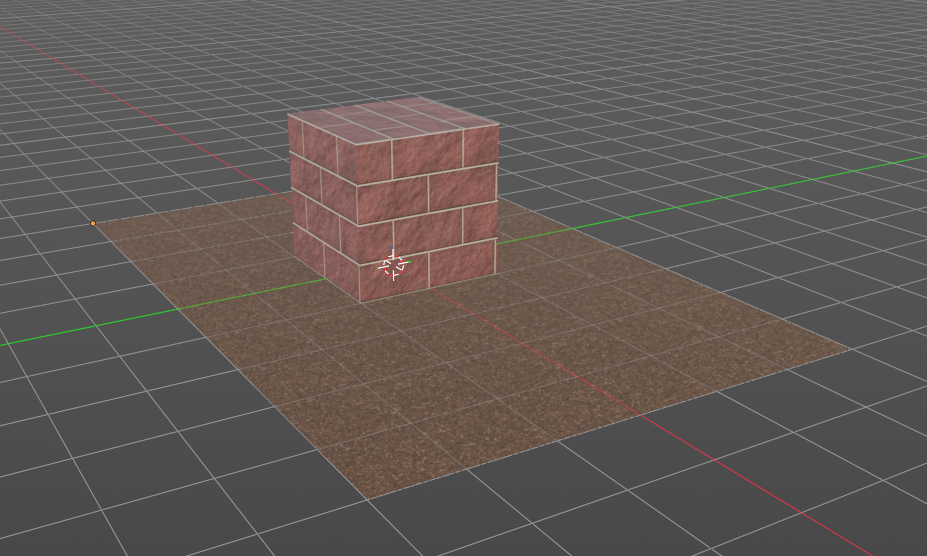
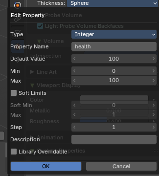

# Description
Euphrosyne is a performant Vulkan and ECS based game engine for stylized games, using Blender as an editor, with in depth mod support.
Euphrosyne was thought out for solo devs / small teams that care about quality and performance. 

# Guide
A guide to walk you through the multiple stages of development is available in the [docs/guide](docs/guide) folder.

# Docs
Docs related to multiple engine components are available in the [docs](docs) folder.

# Community
Euphrosyne's [official community server](https://armada.buzz/invite/naddr1qvzqqqyzz5pzqcacyk2y9vs8py4ef8shl946zfvynxwhcdzrjlnqeez6qp3n8d7vqqqqe54j0k#BAF_KQrG7ko8YPwkM9MvC4yE) is on Armada, a decentralized alternative to Discord. Making an account is just one click, you don't even need a mail or even a username.

# Why would I want to use Blender as my editor?
Most game engines roll their own editor. Why don't we? Well, its better for you and us!
1. It allows you to author your assets directly in the editor, which increases your productivity a lot while level designing
2. Most artists will already know it, which is ideal for small teams that don't have a level designer as any team member which knows Blender will be able to work as one
3. Making a semi-decent editor takes time, a lot of time. Writing code to cook .blend files takes less time. 

For those that would be learning Blender while they're making their game, we actually recommend [Bforartists](https://www.bforartists.co/) over Blender

# What does it looks like?
An introduction to what you will spend 99% of your time doing if you make a game with Euphrosyne.

## Writing gameplay code
Euphrosyne is ECS based, and uses the [flecs](https://www.flecs.dev/flecs/) library as it's ECS engine.
ECS might seem daunting at first but when you learn it and how to architecture code around it, it's quite powerful, intuitive and clean.

Here is an example game mechanic: Health.
````c++
struct Health 
{
    int value;
};

struct HealthModule 
{
    HealthModule(flecs::world& ecs) 
    {
        // 1. Declare your component to flecs
        ecs.component<Health>()
           .member<int>("value")
        
        // 2. Declare the system that kills dead entities
        ecs.system<const Health>("Kill health <= 0 entities") // runs on entities with these components, given a descriptive name
           .kind(flecs::PostUpdate) // run after other systems
           .each([](flecs::entity e, const Health& health) 
           {
                if (health.value <= 0) 
                {
                    e.destruct();
                }    
           });
    }
};
````
And then, somewhere in your game's `ImportEcsModules` function:
```c++
ecs.import<HealthModule>();
```
Congrats, you've created a component and a system that runs on entities with that component!
Now how would we actually create entities that have that component?

## Making an asset
With Blender (or Bforartists) and preferably a level editor plugin such as [Anvil](https://anvilleveldesign.com/), create your asset. In this example,
we are creating a level with an entity with an `Health` component.
### 1. Model out your asset
I've done something quite simple here, if your game's levels looks like that, it might be time to hire a level designer.


### 2. Add the data for the properties you created via custom properties
In the custom properties panel, create a new property, give it a name following the convention `Component.field` and whatever type you want.
In this example, we will go with `Health.value`.


Now, in your game, the top mesh is a new entity with a `Transform` component set to its transform in Blender, an `Health` component with its value set to 0, and all
the components needed to render it.

### 3. Save the file in the right subfolder of your game's `assets` folder

Here, it is a level, so we will save it in `assets/levels`.

Congratulations, the level will now be included in your game, and you will be able to load it, and there will be the entity we just created.
