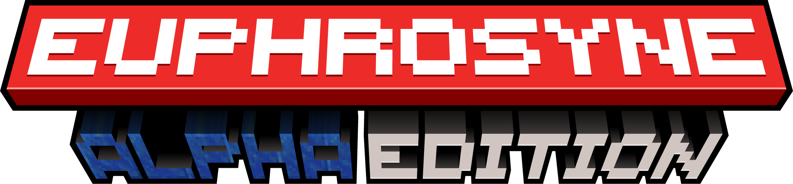

# Description
Euphrosyne is a performance focused Vulkan based game engine for stylized games, using Blender as an editor, with in depth mod support.
Euphrosyne was thought out for solo devs / small teams that care about quality and performance. 

# What is the typical workflow?
1) TODO example doing a level in Blender
2) TODO example scripting a game mechanic

# Guide
A guide to walk you through the multiple stages of development is available in the [docs/guide](docs/guide) folder.

# Docs
Docs related to multiple engine components are available in the [docs](docs) folder.

# Community
TODO: Link to Armada community
